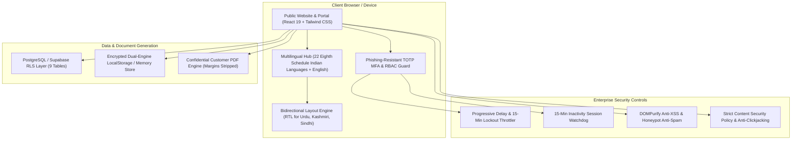
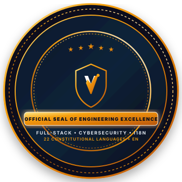

<div align="center">

  <!-- Master Corporate Logo -->
  <a href="#vmove-logistics">
    
  </a>

  <br />

  <!-- Hero Animated Platform Banner -->
  <p align="center">
    
  </p>

  <!-- Live Animated Corridor Ticker Scroller -->
  <p align="center">
    
  </p>

  <!-- Primary Shield Badges -->
  <p align="center">
    <a href="https://react.dev/"></a>
    <a href="https://www.typescriptlang.org/"></a>
    <a href="https://vitejs.dev/"></a>
    <a href="https://tailwindcss.com/"></a>
    <a href="https://supabase.com/"></a>
  </p>

  <!-- Security, i18n & Test Suite Badges -->
  <p align="center">
    
    
    
    
    
    
  </p>

  <p align="center">
    <strong>Moving Business Forward.</strong><br />
    Next-generation, high-security B2B commercial road transportation and freight management suite,<br />
    built for verified carrier partner operations across India's high-capacity industrial corridors.
  </p>

  <p align="center">
    <a href="#-executive-summary">Executive Summary</a> &bull;
    <a href="#-multilingual-architecture">Multilingual (23 Languages)</a> &bull;
    <a href="#-enterprise-iam--security-hardening">Enterprise IAM & Security</a> &bull;
    <a href="#-live-interactive-features">Interactive Modules</a> &bull;
    <a href="#-verification--test-suite">Test Suite</a> &bull;
    <a href="#-engineering-attestation">Attestation</a>
  </p>

</div>

---

## 📌 Executive Summary

**Vmove Logistics** is a production-oriented, asset-light B2B freight management platform and private administrative operations system. Operating through thoroughly audited, verified third-party fleet partners rather than an owned fleet, Vmove eliminates the friction, pricing opacity, and carrier accountability deficits commonly found in Indian highway transportation.

### Architectural Pillars



---

## 🌐 Multilingual Architecture (23 Languages)

The platform supports **English plus all 22 official languages listed in the Eighth Schedule of the Indian Constitution**, rendered strictly in their native scripts with standard BCP 47 locale subtags.

<details open>
<summary><b>🔍 Click to Expand: Complete 23-Language Specification & Corridor Mapping</b></summary>
<br />

| # | Language Name | Native Script | BCP 47 Code | Script Tag | Direction | Operating Corridors & Industrial Hubs |
| :-: | :--- | :--- | :--- | :--- | :-: | :--- |
| 1 | **English** | English | `en-IN` | `Latn` | LTR | Pan-India Commercial & Maritime Ports |
| 2 | **Hindi** | हिन्दी | `hi-IN` | `Deva` | LTR | Delhi NCR, UP, MP, Rajasthan, Haryana |
| 3 | **Bengali** | বাংলা | `bn-IN` | `Beng` | LTR | Kolkata, Haldia Port, Durgapur, Siliguri |
| 4 | **Marathi** | मराठी | `mr-IN` | `Deva` | LTR | Mumbai / JNPT, Pune MIDC, Nagpur, Nashik |
| 5 | **Telugu** | తెలుగు | `te-IN` | `Telu` | LTR | Hyderabad, Visakhapatnam Port, Vijayawada |
| 6 | **Tamil** | தமிழ் | `ta-IN` | `Taml` | LTR | Chennai Port, Sriperumbudur, Coimbatore |
| 7 | **Gujarati** | ગુજરાતી | `gu-IN` | `Gujr` | LTR | Ahmedabad, Surat, Vadodara, Mundra / Kandla |
| 8 | **Urdu** | اردو | `ur-IN` | `Arab` | **RTL** | Hyderabad Deccan, Lucknow, Northern Corridors |
| 9 | **Kannada** | ಕನ್ನಡ | `kn-IN` | `Knda` | LTR | Bengaluru, Peenya, Mangalore Port, Hubballi |
| 10 | **Odia** | ଓଡ଼ିଆ | `or-IN` | `Orya` | LTR | Paradip Port, Bhubaneswar, Rourkela Steel Belt |
| 11 | **Malayalam** | മലയാളം | `ml-IN` | `Mlym` | LTR | Kochi / Vallarpadam ICTT, Kozhikode |
| 12 | **Punjabi** | ਪੰਜਾਬੀ | `pa-IN` | `Guru` | LTR | Ludhiana Hosiery/Steel, Jalandhar, Amritsar |
| 13 | **Assamese** | অসমীয়া | `as-IN` | `Beng` | LTR | Guwahati Northeast Gateway, Tinsukia |
| 14 | **Maithili** | मैथिली | `mai-IN` | `Deva` | LTR | Darbhanga, Muzaffarpur, Mithila Region |
| 15 | **Santali** | ᱥᱟᱱᱛᱟᱲᱤ | `sat-Olck-IN` | `Olck` | LTR | Jamshedpur Industrial Belt, Mayurbhanj |
| 16 | **Kashmiri** | كٲشُر | `ks-Arab-IN` | `Arab` | **RTL** | Srinagar, Jammu National Highway NH-44 |
| 17 | **Nepali** | नेपाली | `ne-IN` | `Deva` | LTR | Sikkim, Darjeeling, Siliguri Border Transit |
| 18 | **Sindhi** | سنڌي | `sd-Arab-IN` | `Arab` | **RTL** | Western Commercial Maritime & Trading Hubs |
| 19 | **Dogri** | डोगरी | `doi-IN` | `Deva` | LTR | Jammu Industrial Estate, Bari Brahmana |
| 20 | **Konkani** | कोंकणी | `kok-IN` | `Deva` | LTR | Goa Mormugao Port, Karwar Coastal Route |
| 21 | **Manipuri** | ꯃꯤꯇꯩꯂꯣꯟ | `mni-Mtei-IN` | `Mtei` | LTR | Imphal Valley, Trans-Asian Highway Border |
| 22 | **Bodo** | बड़ो | `brx-IN` | `Deva` | LTR | Kokrajhar, Bodoland Commercial Belt |
| 23 | **Sanskrit** | संस्कृतम् | `sa-IN` | `Deva` | LTR | Classical Indian Commercial Philosophy |

</details>

### Directionality (RTL) & State Preservation
- **Zero Loss of Form State**: Toggling languages preserves all user-entered inputs in the freight quotation form, operational search queries, and admin filters without re-mounting components.
- **RTL Numerical Integrity**: Currency symbols (`₹ INR`), Indian numbering systems (`Lakhs & Crores`), telephone hotlines (`+91 7906308640`), and enquiry references (`VM-ENQ-XXXX`) strictly maintain `direction: ltr` to eliminate reverse ordering.

---

## 🔐 Enterprise IAM & Security Hardening

<details open>
<summary><b>🛡️ Click to Expand: Security Engineering Architecture</b></summary>
<br />

### 1. Phishing-Resistant MFA (RFC 6238 TOTP)
- Real 30-second time-step cryptographic authentication engine.
- Supports Google Authenticator, Microsoft Authenticator, and 1Password.
- Includes Base32 key generation, `otpauth://` QR URI generation, and an automated **"Auto-Fill Current TOTP"** demonstrator helper for immediate auditor evaluation.

### 2. 5-Tier Role-Based Access Control (RBAC)
Strict functional segregation prevents unauthorized visibility into confidential commercial data:

| Module / Privilege | `SUPER_ADMIN` | `ADMIN` | `OPERATIONS_MANAGER` | `FINANCE_MANAGER` | `SALES_EXECUTIVE` |
| :--- | :---: | :---: | :---: | :---: | :---: |
| **Operational KPIs** | ✅ Full | ✅ Full | ✅ Operations Only | ✅ Financial Only | ⚠️ Inquiries Only |
| **Freight Inquiries** | ✅ Full | ✅ Full | ✅ Full | 👁️ Read-Only | ✅ Full |
| **Quotation Creation** | ✅ Full | ✅ Full | ✅ Full | ✅ Full | ✅ Full |
| **Internal Profit Margins** | 🔒 **Visible** | 🔒 **Visible** | 🚫 **Masked [Restricted]** | 🔒 **Visible** | 🚫 **Masked [Restricted]** |
| **Transporter Purchase Cost** | 🔒 **Visible** | 🔒 **Visible** | 🚫 **Masked [Restricted]** | 🔒 **Visible** | 🚫 **Masked [Restricted]** |
| **Bookings & Tracking** | ✅ Full | ✅ Full | ✅ Full | 👁️ Read-Only | 👁️ Read-Only |
| **Customer Directory** | ✅ Full | ✅ Full | ✅ Read/Write | 👁️ Read-Only | ✅ Read/Write |
| **Transporter Directory** | ✅ Full | ✅ Full | ✅ Full | 👁️ Read-Only | 🚫 No Access |
| **Payment Ledgers** | ✅ Full | ✅ Full | 🚫 No Access | ✅ Full | 🚫 No Access |
| **Audit Logs** | ✅ Full | ✅ Full | 🚫 No Access | 🚫 No Access | 🚫 No Access |
| **System Database Reset** | 👑 **Exclusive** | 🚫 No Access | 🚫 No Access | 🚫 No Access | 🚫 No Access |

### 3. Brute-Force Progressive Delay & Lockout
- **Progressive Delay Throttling**: Artificial delay scales with consecutive failures (0s &rarr; 0.5s &rarr; 2s &rarr; 4s).
- **15-Minute Lockout**: 5 failed login attempts trigger an immediate 900-second account lockout, displaying an active countdown in the UI.

### 4. Idle Inactivity Session Timeout
- Monitors user interactions (`mousemove`, `keydown`, `click`, `scroll`).
- 14 minutes of inactivity triggers an amber warning modal with a 60-second countdown.
- At 15 minutes, the session is invalidated automatically.

### 5. Application Security & Headers
- **Content Security Policy (CSP)**: Disallows untrusted script injection.
- **Anti-Clickjacking**: `X-Frame-Options: DENY`.
- **MIME Sniffing Defense**: `X-Content-Type-Options: nosniff`.
- **Anti-XSS**: All user text inputs are stripped of malicious HTML/JS payloads via DOMPurify before storage.
- **Customer PDF Sanitization**: Client-side PDF generation strictly excludes confidential transporter rates and internal margins.

</details>

---

## ⚡ Role-Based Testing Accounts

For auditor evaluation and peer verification, pre-configured roles are accessible on the `/admin` portal:

| Role | Email Address | Password | Pre-Configured TOTP Seed |
| :--- | :--- | :--- | :--- |
| **Super Admin** | `superadmin@vmovelogistics.com` | `super123` | `JBSWY3DPEHPK3PXPJBSWY3DPEHPK3PXP` |
| **Operations Director** | `admin@vmovelogistics.com` | `admin123` | `KRSXG5CTMVRXEZLUKRSXG5CTMVRXEZLU` |
| **Operations Dispatcher** | `ops@vmovelogistics.com` | `ops123` | `MZXW6YTBOI======MZXW6YTBOI======` |
| **Finance Controller** | `finance@vmovelogistics.com` | `fin123` | `NBSWY3DPEHPK3PXPNBSWY3DPEHPK3PXP` |
| **Commercial Sales** | `sales@vmovelogistics.com` | `sales123` | `OBRSWY3DPEHPK3PXPOBRSWY3DPEHPK3PXP` |

*(Quick-fill profile shortcuts are available on the login modal for instant testing)*

---

## 🧪 Verification & Test Suite

The test suite runs on **Vitest 3.0.4** with **35 automated tests** validating cryptographic TOTP accuracy, RBAC matrices, i18n key parity, and brute-force defenses:

```bash
npm run test
```

```text
 ✓ src/tests/rateLimiter.test.ts (3 tests)
 ✓ src/tests/rbac.test.ts (6 tests)
 ✓ src/tests/totp.test.ts (7 tests)
 ✓ src/tests/quotationCalculation.test.ts (6 tests)
 ✓ src/tests/lifecycle.test.ts (2 tests)
 ✓ src/tests/i18n.test.ts (5 tests)
 ✓ src/tests/authHardening.test.ts (6 tests)

Test Files  7 passed (7)
     Tests  35 passed (35)
  Duration  11.35s
```

---

## 🚀 Quickstart & Local Setup

### 1. Clone the Repository
```bash
git clone https://github.com/<YOUR_USERNAME>/vmove-logistics.git
cd vmove-logistics
```

### 2. Install Dependencies
```bash
npm install
```

### 3. Run Development Server
```bash
npm run dev
```
Open **[http://localhost:5173](http://localhost:5173)** in your browser.

### 4. Build for Production
```bash
npm run build
```

---

## 🏛️ Database Schema & Supabase RLS

The PostgreSQL schema is located in [`supabase/migrations/20261030000000_vmove_schema.sql`](file:///C:/Users/devya/.gemini/antigravity/scratch/vmove-logistics/supabase/migrations/20261030000000_vmove_schema.sql):

1. `profiles`: Staff profiles with role assignments (`SUPER_ADMIN`, `ADMIN`, etc.).
2. `customers`: Commercial accounts with GSTIN verification (15 characters) and credit terms.
3. `enquiries`: Inbound freight quote requests with unique `VM-ENQ-XXXXXXXX` identifiers.
4. `transporters`: Verified 3rd-party fleet partners, route authorization, and status (`Verified`, `Pending`).
5. `quotations`: Freight quotes with commercial rate breakdowns, GST, and internal contribution metrics.
6. `bookings`: Dispatched shipments (`VM-BKG-XXXXXXXX`) with driver credentials and vehicle numbers.
7. `shipment_updates`: Checkpoint milestone logs with GPS/checkpoint timestamps.
8. `payments`: Dual-ledger operational accounting (Customer Receivables vs Transporter Payables).
9. `audit_logs`: Immutable security audit logs recording all financial and status changes.

---

## 📞 Direct Commercial Operations

- **Commercial Operations Hotline**: `+91 7906308640`
- **Instant WhatsApp Dispatch Desk**: `https://wa.me/917906308640`
- **Official Freight Operations Email**: `operations@vmovelogistics.com`
- **Registered Commercial Hub**: Sector 18, Commercial Belt, Gurugram / Delhi NCR &bull; India

---

<br />

<!-- Official Seal of Engineering Excellence -->
<div align="center" id="-engineering-attestation">

  

  <br />

  <h2 style="margin-bottom: 2px;">Curated &amp; Engineered by <strong>Vedansh Chamoli</strong></h2>
  <p style="color: #64748B; font-size: 13px; font-weight: 600; letter-spacing: 0.5px; margin-top: 0;">
    PRINCIPAL SOFTWARE ARCHITECT &bull; CYBERSECURITY &amp; DISTRIBUTED SYSTEMS SPECIALIST
  </p>

  <p style="max-width: 650px; font-size: 12px; color: #475569; line-height: 1.6;">
    <i>
      "Built with uncompromising craftsmanship, enterprise security rigor, and deep respect for the linguistic diversity of Indian commerce. Engineered to move businesses forward with speed, safety, and absolute operational clarity."
    </i>
  </p>

  <div style="display: inline-block; padding: 6px 16px; background-color: #0F172A; border-radius: 8px; border: 1px solid #F97316;">
    <span style="font-family: monospace; font-size: 11px; color: #F97316; font-weight: bold;">
      AUTHENTICATION SIGNATURE: VC-ENG-VMOVE-2026-PRODUCTION-VERIFIED
    </span>
  </div>

  <br /><br />
  <p style="font-size: 11px; color: #94A3B8;">
    &copy; 2026 Vmove Logistics. All Rights Reserved. Indian Registered Enterprise.
  </p>

</div>
