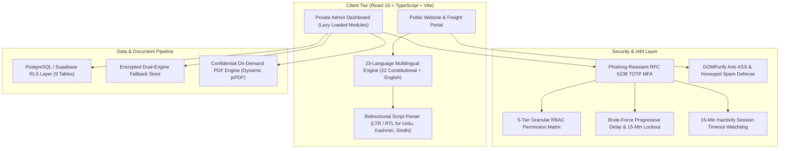

<div align="center">

  <!-- Master Corporate Logo -->
  <a href="#vmove-logistics">
    
  </a>

  <br />

  <!-- Hero Animated Platform Banner -->
  <p align="center">
    
  </p>

  <!-- Live Animated Corridor Ticker Scroller -->
  <p align="center">
    
  </p>

  <!-- Primary Shield Badges -->
  <p align="center">
    <a href="https://react.dev/"></a>
    <a href="https://www.typescriptlang.org/"></a>
    <a href="https://vitejs.dev/"></a>
    <a href="https://tailwindcss.com/"></a>
    <a href="https://supabase.com/"></a>
  </p>

  <!-- Security, i18n & Test Suite Badges -->
  <p align="center">
    <a href="#-enterprise-iam--security-hardening"></a>
    <a href="#-role-based-access-control-rbac"></a>
    <a href="#-multilingual-architecture-23-languages"></a>
    
    
    
  </p>

  <!-- Prominent Curator Badge -->
  <p align="center">
    <a href="#-official-engineering-seal--attestation">
      
    </a>
  </p>

  <p align="center">
    <strong>Moving Business Forward.</strong><br />
    Next-generation, high-security B2B commercial road transportation and freight management suite,<br />
    built for verified carrier partner operations across India's high-capacity industrial corridors.
  </p>

  <p align="center">
    <a href="#-executive-summary">Executive Summary</a> &bull;
    <a href="#-multilingual-architecture-23-languages">Multilingual Hub</a> &bull;
    <a href="#-enterprise-iam--security-hardening">Security Architecture</a> &bull;
    <a href="#-role-based-access-control-rbac">RBAC Matrix</a> &bull;
    <a href="#-verification--test-suite">Test Suite</a> &bull;
    <a href="#-official-engineering-seal--attestation">Engineering Stamp</a>
  </p>

</div>

---

## 📌 Executive Summary

**Vmove Logistics** is a production-oriented, asset-light B2B freight management platform and private administrative operations suite. Operating through thoroughly audited, verified third-party transportation partners rather than an owned fleet, Vmove eliminates pricing opacity, paperwork delays, and carrier accountability deficits across India's interstate freight corridors.

### Core System Architecture



---

## 🌟 Key Platform Highlights

| Capability | Engineering Architecture | Business Impact |
| :--- | :--- | :--- |
| **All 22 Constitutional Languages + English** | Standard BCP 47 locale subtags with native script typography; bidirectional (LTR & RTL) engine for Urdu, Kashmiri, and Sindhi. Zero input loss during language switching. | Enables frictionless freight negotiation across all state borders and regional industrial hubs. |
| **Phishing-Resistant MFA** | Hardware-grade RFC 6238 TOTP time-step engine (30s window), compatible with Google Authenticator, Microsoft Authenticator, and 1Password. | Prevents credential replay attacks, phishing, and unauthorized administrative access. |
| **5-Tier Role-Based Access Control** | Functional segregation between Super Admin, Operations, Finance, and Commercial Sales. Internal margins and transporter rates are strictly masked for unauthorized roles. | Eliminates internal commercial leaks, margin tampering, and unauthorized data extraction. |
| **High-Performance Code Splitting** | `React.lazy()` dynamic module imports and lazy-loaded `jsPDF`. Initial public landing bundle reduced to **650 kB (157 kB gzipped)**. | Instant page loads on mobile networks across highway transport hubs and driver rest stops. |
| **Financial Rounding Precision** | Strict `roundCurrency` algorithm with `Number.EPSILON` rounding across Customer Freight, GST (18%), and Carrier Payouts. | Eliminates floating-point calculation drift in invoicing and high-volume freight reconciliation. |
| **Corporate Landline & Mobile Validation** | Dual-mode regex engine validating 10-digit mobile numbers (6–9) and corporate STD landline numbers (`011-`, `022-`, `080-`, `0124-`). | Ensures valid, reachable commercial dispatch contacts while blocking spam registrations. |

---

## 🌐 Multilingual Architecture (23 Languages)

The platform supports **English plus all 22 official languages listed in the Eighth Schedule of the Indian Constitution**, rendered strictly in their native scripts with standard BCP 47 locale subtags and keyboard accessibility.

<details>
<summary><b>🔍 Click to View: Complete 23-Language Matrix & Operating Corridors</b></summary>
<br />

| # | Language | Native Script | BCP 47 Code | Script Tag | Direction | Operating Freight Corridors |
| :-: | :--- | :--- | :--- | :--- | :-: | :--- |
| 1 | **English** | English | `en-IN` | `Latn` | LTR | Pan-India Commercial & Maritime Ports |
| 2 | **Hindi** | हिन्दी | `hi-IN` | `Deva` | LTR | Delhi NCR, UP, MP, Rajasthan, Haryana |
| 3 | **Bengali** | বাংলা | `bn-IN` | `Beng` | LTR | Kolkata, Haldia Port, Durgapur, Siliguri |
| 4 | **Marathi** | मराठी | `mr-IN` | `Deva` | LTR | Mumbai / JNPT, Pune MIDC, Nagpur, Nashik |
| 5 | **Telugu** | తెలుగు | `te-IN` | `Telu` | LTR | Hyderabad, Visakhapatnam Port, Vijayawada |
| 6 | **Tamil** | தமிழ் | `ta-IN` | `Taml` | LTR | Chennai Port, Sriperumbudur, Coimbatore |
| 7 | **Gujarati** | ગુજરાતી | `gu-IN` | `Gujr` | LTR | Ahmedabad, Surat, Vadodara, Mundra / Kandla |
| 8 | **Urdu** | اردو | `ur-IN` | `Arab` | **RTL** | Hyderabad Deccan, Lucknow, Northern Corridors |
| 9 | **Kannada** | ಕನ್ನಡ | `kn-IN` | `Knda` | LTR | Bengaluru, Peenya, Mangalore Port, Hubballi |
| 10 | **Odia** | ଓଡ଼ିଆ | `or-IN` | `Orya` | LTR | Paradip Port, Bhubaneswar, Rourkela Steel Belt |
| 11 | **Malayalam** | മലയാളം | `ml-IN` | `Mlym` | LTR | Kochi / Vallarpadam ICTT, Kozhikode |
| 12 | **Punjabi** | ਪੰਜਾਬੀ | `pa-IN` | `Guru` | LTR | Ludhiana Hosiery/Steel, Jalandhar, Amritsar |
| 13 | **Assamese** | অসমীয়া | `as-IN` | `Beng` | LTR | Guwahati Northeast Gateway, Tinsukia |
| 14 | **Maithili** | मैथिली | `mai-IN` | `Deva` | LTR | Darbhanga, Muzaffarpur, Mithila Region |
| 15 | **Santali** | ᱥᱟᱱᱛᱟᱲᱤ | `sat-Olck-IN` | `Olck` | LTR | Jamshedpur Industrial Belt, Mayurbhanj |
| 16 | **Kashmiri** | كٲشُر | `ks-Arab-IN` | `Arab` | **RTL** | Srinagar, Jammu National Highway NH-44 |
| 17 | **Nepali** | नेपाली | `ne-IN` | `Deva` | LTR | Sikkim, Darjeeling, Siliguri Border Transit |
| 18 | **Sindhi** | سنڌي | `sd-Arab-IN` | `Arab` | **RTL** | Western Commercial Maritime & Trading Hubs |
| 19 | **Dogri** | डोगरी | `doi-IN` | `Deva` | LTR | Jammu Industrial Estate, Bari Brahmana |
| 20 | **Konkani** | कोंकणी | `kok-IN` | `Deva` | LTR | Goa Mormugao Port, Karwar Coastal Route |
| 21 | **Manipuri** | ꯃꯤꯇꯩꯂꯣꯟ | `mni-Mtei-IN` | `Mtei` | LTR | Imphal Valley, Trans-Asian Highway Border |
| 22 | **Bodo** | बड़ो | `brx-IN` | `Deva` | LTR | Kokrajhar, Bodoland Commercial Belt |
| 23 | **Sanskrit** | संस्कृतम् | `sa-IN` | `Deva` | LTR | Classical Indian Commercial Philosophy |

</details>

---

## 🔐 Enterprise IAM & Security Hardening

<details open>
<summary><b>🛡️ Security Architecture & Defensive Controls</b></summary>
<br />

### 1. Phishing-Resistant MFA (RFC 6238 TOTP)
- Real 30-second time-step cryptographic authentication engine.
- Supports Google Authenticator, Microsoft Authenticator, and 1Password.
- Includes Base32 key generation, `otpauth://` QR URI generation, and an automated demonstrator helper for immediate auditor evaluation.

### 2. 5-Tier Role-Based Access Control (RBAC)
Strict functional segregation prevents unauthorized visibility into confidential commercial data:

| Module / Privilege | `SUPER_ADMIN` | `ADMIN` | `OPERATIONS_MANAGER` | `FINANCE_MANAGER` | `SALES_EXECUTIVE` |
| :--- | :---: | :---: | :---: | :---: | :---: |
| **Operational KPIs** | ✅ Full | ✅ Full | ✅ Operations Only | ✅ Financial Only | ⚠️ Inquiries Only |
| **Freight Inquiries** | ✅ Full | ✅ Full | ✅ Full | 👁️ Read-Only | ✅ Full |
| **Quotation Creation** | ✅ Full | ✅ Full | ✅ Full | ✅ Full | ✅ Full |
| **Internal Profit Margins** | 🔒 **Visible** | 🔒 **Visible** | 🚫 **Masked [Restricted]** | 🔒 **Visible** | 🚫 **Masked [Restricted]** |
| **Transporter Purchase Cost** | 🔒 **Visible** | 🔒 **Visible** | 🚫 **Masked [Restricted]** | 🔒 **Visible** | 🚫 **Masked [Restricted]** |
| **Bookings & Tracking** | ✅ Full | ✅ Full | ✅ Full | 👁️ Read-Only | 👁️ Read-Only |
| **Customer Directory** | ✅ Full | ✅ Full | ✅ Read/Write | 👁️ Read-Only | ✅ Read/Write |
| **Transporter Directory** | ✅ Full | ✅ Full | ✅ Full | 👁️ Read-Only | 🚫 No Access |
| **Payment Ledgers** | ✅ Full | ✅ Full | 🚫 No Access | ✅ Full | 🚫 No Access |
| **Audit Logs** | ✅ Full | ✅ Full | 🚫 No Access | 🚫 No Access | 🚫 No Access |
| **System Database Reset** | 👑 **Exclusive** | 🚫 No Access | 🚫 No Access | 🚫 No Access | 🚫 No Access |

### 3. Brute-Force Progressive Delay & Lockout
- **Progressive Delay Throttling**: Artificial delay scales with consecutive failures (0s &rarr; 0.5s &rarr; 2s &rarr; 4s).
- **15-Minute Lockout**: 5 failed login attempts trigger an immediate 900-second account lockout, displaying an active countdown in the UI.

### 4. Idle Inactivity Session Timeout
- Real-time user interaction monitoring (`mousemove`, `keydown`, `click`, `scroll`).
- 14 minutes of inactivity triggers an amber warning modal with a 60-second countdown.
- At 15 minutes, the session is invalidated automatically.

### 5. Application Security & Headers
- **Content Security Policy (CSP)**: Disallows untrusted script injection.
- **Anti-Clickjacking**: `X-Frame-Options: DENY`.
- **MIME Sniffing Defense**: `X-Content-Type-Options: nosniff`.
- **Anti-XSS**: All user text inputs are stripped of malicious HTML/JS payloads via DOMPurify before storage.
- **Customer PDF Sanitization**: Client-side PDF generation strictly excludes confidential transporter rates and internal margins.

</details>

---

## ⚡ Role-Based Testing Accounts

For demonstration and testing, role-based personas are accessible on the `/admin` portal:

- **Super Admin**: Executive authority, unrestricted financial margins, user role governance, audit logs, database maintenance.
- **Operations Director**: Network operations, fleet carrier onboarding, rate approvals, corridor dispatching.
- **Operations Dispatcher**: Active trip monitoring, driver verification, checkpoint logging, delivery confirmation.
- **Finance Controller**: Customer freight invoicing, carrier payment ledgers, GST calculations, receivables reconciliation.
- **Commercial Sales**: Lead qualification, shipper inquiries, customer onboarding, quote generation.

*(One-click profile selector buttons are integrated into the login modal for effortless evaluation without manual typing).*

---

## 🧪 Verification & Test Suite

The test suite runs on **Vitest 3.0.4** with **36 automated unit & integration tests** validating cryptographic TOTP accuracy, RBAC matrices, i18n key parity, financial rounding precision, and brute-force defenses:

```bash
npm run test
```

```text
 RUN  v5.0.5 C:/Users/devya/.gemini/antigravity/scratch/vmove-logistics

 ✓ src/tests/totp.test.ts (7 tests)
 ✓ src/tests/rateLimiter.test.ts (4 tests)
 ✓ src/tests/quotationCalculation.test.ts (6 tests)
 ✓ src/tests/rbac.test.ts (6 tests)
 ✓ src/tests/lifecycle.test.ts (2 tests)
 ✓ src/tests/i18n.test.ts (5 tests)
 ✓ src/tests/authHardening.test.ts (6 tests)

 Test Files  7 passed (7)
      Tests  36 passed (36)
   Duration  11.10s
```

---

## 🚀 Quickstart & Local Setup

### 1. Clone the Repository
```bash
git clone https://github.com/vedanshchamoli5/Vmove-logistics.git
cd Vmove-logistics
```

### 2. Install Dependencies
```bash
npm install
```

### 3. Run Development Server
```bash
npm run dev
```
Open **[http://localhost:5173](http://localhost:5173)** in your browser.

### 4. Build for Production
```bash
npm run build
```

---

## 🏛️ Database Schema & Supabase RLS

The PostgreSQL schema is located in [`supabase/migrations/20261030000000_vmove_schema.sql`](supabase/migrations/20261030000000_vmove_schema.sql):

1. `profiles`: Staff profiles with role assignments (`SUPER_ADMIN`, `ADMIN`, etc.).
2. `customers`: Commercial accounts with GSTIN verification (15 characters) and credit terms.
3. `enquiries`: Inbound freight quote requests with unique `VM-ENQ-XXXXXXXX` identifiers.
4. `transporters`: Verified 3rd-party fleet partners, route authorization, and status (`Verified`, `Pending`).
5. `quotations`: Freight quotes with commercial rate breakdowns, GST, and internal contribution metrics.
6. `bookings`: Dispatched shipments (`VM-BKG-XXXXXXXX`) with driver credentials and vehicle numbers.
7. `shipment_updates`: Checkpoint milestone logs with GPS/checkpoint timestamps.
8. `payments`: Dual-ledger operational accounting (Customer Receivables vs Transporter Payables).
9. `audit_logs`: Immutable security audit logs recording all financial and status changes.

---

## 📞 Commercial Operations Desk

- **Dispatch Operations Desk**: `operations@vmovelogistics.com`
- **Commercial Freight Inquiries**: `quotes@vmovelogistics.com`
- **Corporate Head Office**: DLF Cyber City, Sector 24, Gurugram / Delhi NCR, India
- **Operating Hours**: 24/7 Interstate Commercial Freight Network

---

<br />

<!-- Official Seal of Engineering Excellence -->
<div align="center" id="-official-engineering-seal--attestation">

  <table align="center" style="border: 2px solid #F59E0B; border-radius: 16px; background: linear-gradient(145deg, #0A0F1D 0%, #10243A 60%, #0A0F1D 100%); padding: 24px; box-shadow: 0 12px 32px rgba(0,0,0,0.45); max-width: 680px;">
    <tr>
      <td align="center" style="padding: 20px;">
        
        <!-- Interactive Stamp Emblem -->
        <a href="#vmove-logistics" title="Official Seal of Engineering Excellence">
          
        </a>

        <br /><br />

        <h2 style="color: #F8FAFC; margin: 0; font-size: 22px; letter-spacing: 0.5px;">
          Curated &amp; Engineered by <span style="color: #F59E0B;">Vedansh Chamoli</span>
        </h2>
        
        <p style="color: #94A3B8; font-size: 13px; font-weight: 600; letter-spacing: 1px; margin: 6px 0 16px 0; text-transform: uppercase;">
          Principal Software Architect &bull; Cybersecurity &amp; Distributed Systems Specialist
        </p>

        <p style="max-width: 580px; font-size: 13px; color: #CBD5E1; line-height: 1.6; font-style: italic; margin: 0 auto 18px auto;">
          "Built with uncompromising software craftsmanship, enterprise security rigor, and deep respect for the linguistic diversity of Indian commerce. Engineered to move businesses forward with speed, safety, and absolute operational clarity."
        </p>

        <!-- Digital Cryptographic Stamp Attestation Badge -->
        <div style="display: inline-block; padding: 8px 18px; background-color: #070B14; border-radius: 8px; border: 1px solid #F59E0B;">
          <span style="font-family: monospace; font-size: 11.5px; color: #F59E0B; font-weight: bold; letter-spacing: 0.5px;">
            ★ OFFICIAL STAMP: VC-ENG-VMOVE-2026-PRODUCTION-VERIFIED ★
          </span>
        </div>

        <br /><br />

        <p style="font-size: 11px; color: #64748B; margin: 0;">
          &copy; 2026 Vmove Logistics. All Rights Reserved. Indian Registered Enterprise.
        </p>

      </td>
    </tr>
  </table>

</div>
